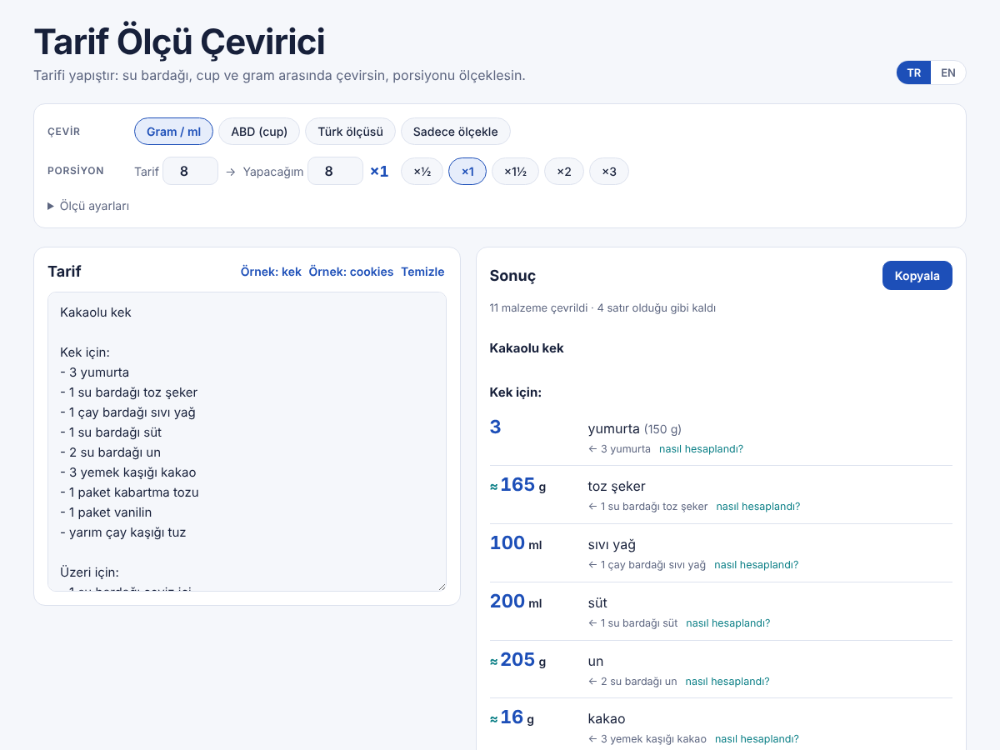

# Recipe Unit Converter · Tarif Ölçü Çevirici

**Paste a recipe and get it back in grams, US cups or Turkish cups, scaled to the number of servings you need.** Runs entirely in the browser, works offline once loaded, no sign-up.

**Live:** https://eyildirim61.github.io/recipe-units/



## Why

Turkish recipes are written in *su bardağı*, *çay bardağı* and *tatlı kaşığı*; American ones in cups and tablespoons; European ones in grams. Converting between them is not just arithmetic: a cup of flour and a cup of sugar have very different weights, and "1 su bardağı" itself means 200 ml in some kitchens and 250 ml in others.

Existing converters work one ingredient at a time and ignore Turkish measures. This one reads the whole recipe as written:

```
- 2 su bardağı un              ->  ≈ 205 g un
- yarım çay kaşığı tuz         ->  ≈ 3 g tuz
- 1 çay bardağı sıvı yağ       ->  100 ml sıvı yağ
- Un: 2-3 yemek kaşığı         ->  ≈ 15–23 g Un
2 1/4 cups all-purpose flour   ->  ≈ 270 g all-purpose flour
1 T honey                      ->  ≈ 21 g honey
Bake at 350 F for 10 minutes.  ->  (left as written)
```

## What it understands

- **Quantities:** `2`, `2,5`, `1 1/2`, `1½`, `½`, ranges `2-3` / `2 to 3` / `2 ila 3`, and words: *yarım, çeyrek, bir buçuk, iki…, half, a, one…*
- **Units:** su bardağı, çay bardağı, kahve fincanı, yemek / tatlı / çay kaşığı · cup, tbsp (`T`), tsp (`t`), fl oz · g, kg, ml, l · oz, lb. Pieces (*adet, tane*) and units that cannot be converted (*paket, tutam, diş, pinch, clove*) are scaled but kept as written.
- **Layout:** quantity before or after the ingredient (`2 su bardağı un`, `Un: 2 su bardağı`), bullets and numbering, alternative quantities in brackets (`200 g (1½ su bardağı) ceviz`), modifiers (*tepeleme, silme, heaped, level*).
- **Ingredients:** about 90 common ingredients in Turkish and English, matched by their longest name (*pudra şekeri* is not *şeker*, *galeta unu* is not *un*) and with Turkish suffixes (*unu, şekeri, suyu*).
- **Safety rails:** instructions such as *"180 derecede 35 dakika pişirin"* are never scaled. Ingredients whose weight varies too much (kosher salt, sea salt, fresh yeast, strained yogurt) are deliberately left without a weight, so they are not mistaken for a similar ingredient.

## Where the numbers come from

Every ingredient weight is traced to a published source, stored exactly as the source states it, and converted to grams per millilitre in code. You can check the table line by line in [`src/ingredients.js`](src/ingredients.js).

- **[King Arthur Baking ingredient weight chart](https://www.kingarthurbaking.com/learn/ingredient-weight-chart)** for almost everything. It measures consistently (flour spooned into the cup and levelled).
- **Turkish measurement tables** ([yemek.com](https://yemek.com/bardak-olculeri/), egitimsistem.com) for a few Turkish staples that the chart does not cover: lentils, dried chickpeas and beans, orzo, tomato paste.

Turkish sources disagree with each other: for "1 su bardağı un" they give 100 g, 120 g or 140 g, and they define the su bardağı itself as 200 or 250 ml. Rather than pick a number per ingredient from inconsistent tables, the converter uses one consistent measuring method and makes the cup size a setting (200 ml by default, 250 ml optional; tatlı kaşığı 10 or 5 ml). As a cross-check, it gives 1 su bardağı of sugar as ≈ 165 g, inside the 160–170 g range the Turkish tables quote.

Results that depend on an ingredient's weight, or that were rounded to a kitchen fraction by more than 5%, are marked with **≈**. Each line can show how it was calculated.

## Run it locally

No build step and no dependencies: it is plain HTML and JavaScript modules.

```bash
git clone https://github.com/eyildirim61/recipe-units.git
cd recipe-units
python3 -m http.server 8000      # then open http://localhost:8000
npm test                          # Node 18+; uses the built-in test runner
```

## How it is built

| File | Role |
|---|---|
| `src/units.js` | Unit definitions (Turkish, US, metric) and the adjustable Turkish measures |
| `src/ingredients.js` | Ingredient names and sourced densities |
| `src/text.js` | Turkish-aware case folding that keeps string positions aligned |
| `src/parse.js` | Reads a recipe line: quantity, range, modifier, unit, ingredient |
| `src/convert.js` | Picks the output unit, converts, scales, rounds to kitchen fractions |
| `src/format.js` | Fractions (½, ⅓, ¾), decimal commas, sensible rounding |
| `src/app.js` | The page: input, options, rendering, copy, Turkish / English interface |

The parsing and conversion logic is pure functions with no access to the page, covered by tests in `tests/`.

## Publishing on GitHub Pages

Repository **Settings → Pages → Build and deployment → Deploy from a branch → `main` / root**. The site appears at `https://<username>.github.io/recipe-units/` a minute later.

## Ideas

- Oven temperatures (°F ↔ °C, gas mark) in instruction lines
- A "pan size" scaler (round 24 cm ↔ square 20 cm)
- Share a converted recipe as a link

## License

MIT
